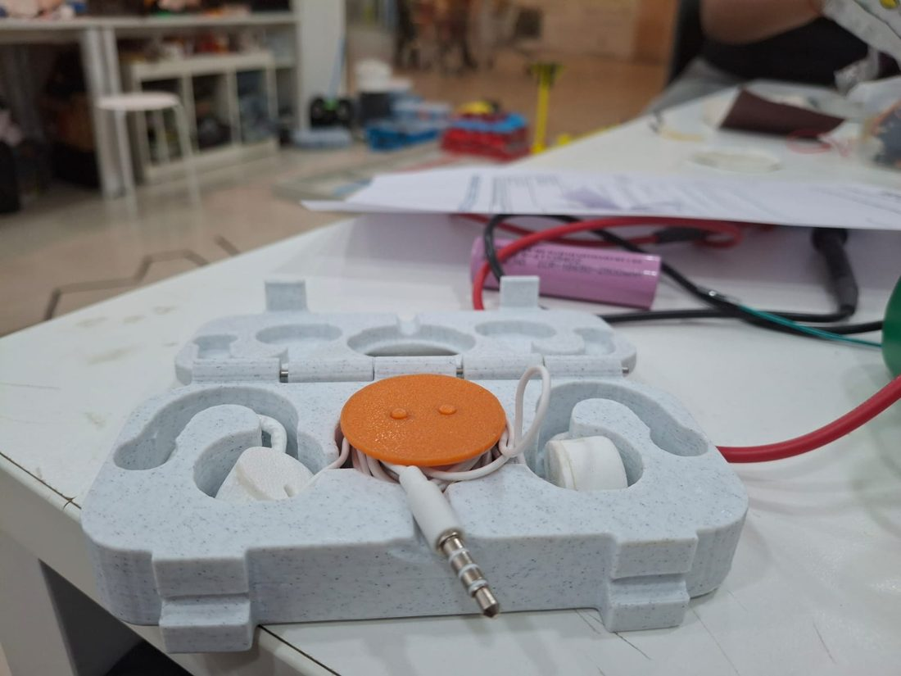
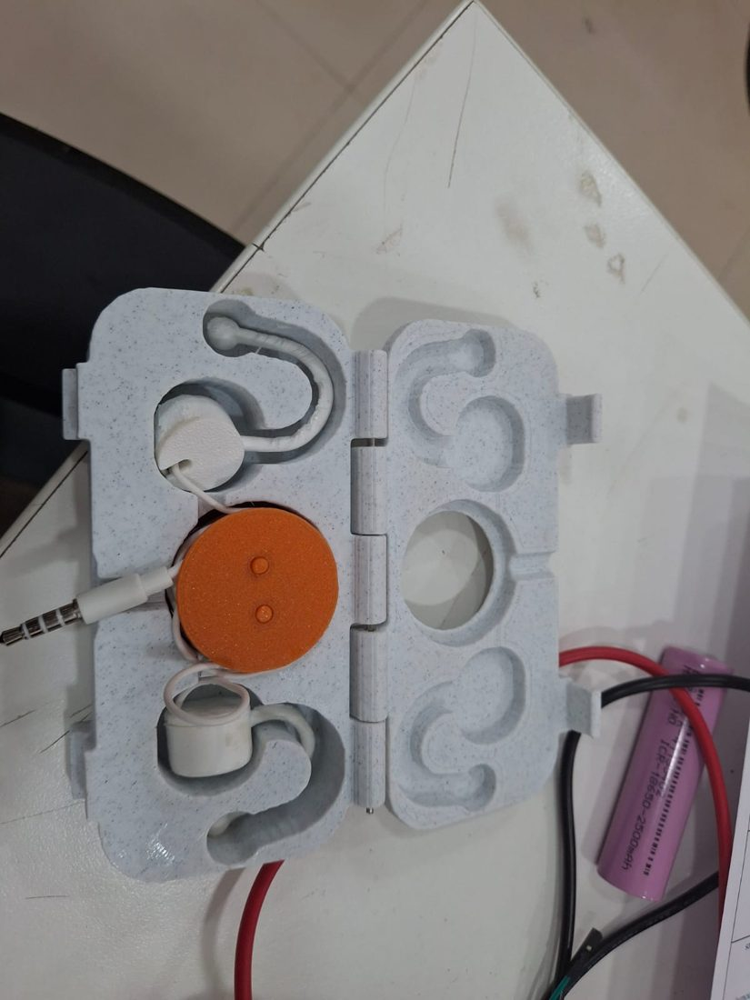
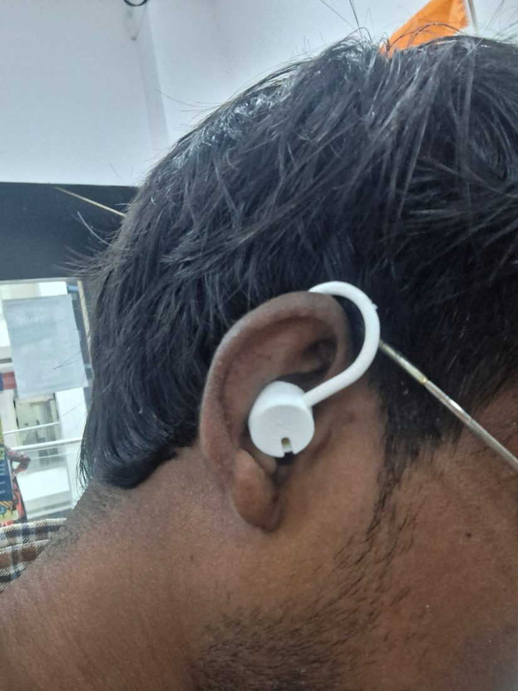
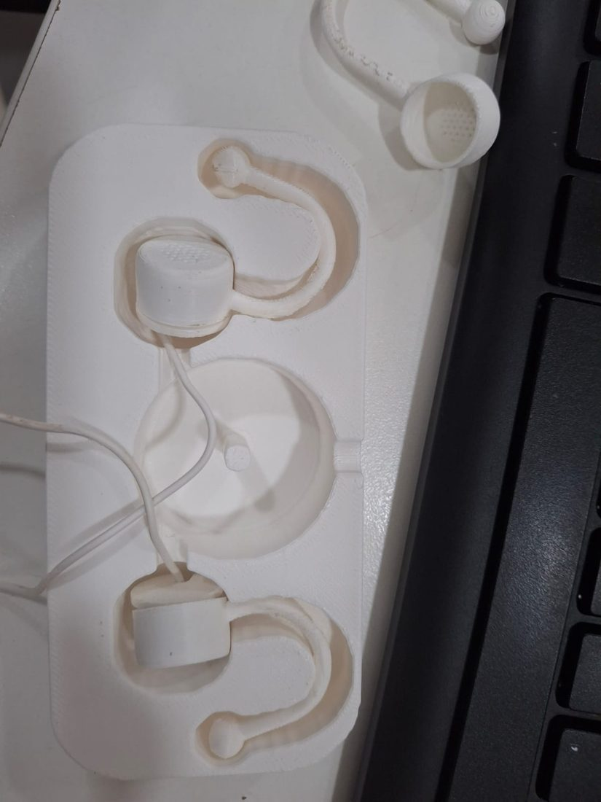

# Open-Ear Wired Earbuds (3D-printed)

> Part of [Ajay Ummadi's portfolio](https://makerworkslab.in/ajayummadi/projects/open-ear-earbuds/), with an interactive 3D preview of the earbud and the reel case. Built at [MakerWorks Lab](https://makerworkslab.in/), Mumbai.

| | |
|---|---|
|  |  |
|  |  |

*Photos: the printed pocket case with its cable reel, one earphone worn, and a white printed case. The sound test worked; loudness and frequency response have not been measured yet.*

Open-ear clip earbuds built around a salvaged wired-earphone driver (from an Ambrane Stringz 02). The egg-shaped pod sits in front of the ear canal with the grille angled toward it, a C-shaped arm goes over the ear, and a ball at the end rests behind it. The driver's original cable stays attached (no re-soldering).

## Why this exists

**The problem:** normal earbuds block the ear canal. You can't hear traffic, people or alarms, long sessions get uncomfortable and sweaty, and cheap wired earphones often die within months (one side stops working).

**What this does:** it turns a salvaged driver (from a 249-rupee Ambrane pair) into open-ear earphones. The pod sits in front of the canal and points at it, held by an arm over the ear. The canal stays open, so you hear the music and your surroundings together. Nothing goes into the ear.

**Good for:** desk or office work where you still need to hear people, walking or cycling where you want to hear traffic, long listening sessions without ear fatigue, and calls where you want to hear your own voice normally.

**Why build it instead of buying**
- Open-ear products (Shokz, Sony LinkBuds, Bose Ultra Open) cost far more than this build: roughly Rs 10,000 to Rs 25,000.
- It reuses a driver that would otherwise be thrown away.
- It is wired and passive: no battery, no charging, no pairing, no audio delay, and no radio signal (no Bluetooth or Wi-Fi). Note that Bluetooth radio is low power and is not shown to be harmful, so this is a preference, not a safety claim.
- It is repairable: a broken arm or cap means reprinting one part.
- It is adjustable to your own ears (left and right can differ).

**Limits:** open-ear sound is quieter and has less bass than in-ear, so it suits quiet to moderate places. People nearby can hear it at higher volumes. It is not tested for sweat or water. The fit is tuned to one person's ears; others may need `ARM_R` and `ARM_RISE` changed. A louder driver (105 dB or more) would help.

## Files

| File | What it is |
|---|---|
| `earbud_shell.py` | Blender script that builds and exports the shell and cap. Run in Blender: Scripting tab > Open > Run Script. |
| `stl/earbud_shell_egg_left.stl` | Egg pod + arm + end ball, **left ear** (`SIDE = 1`). |
| `stl/earbud_shell_egg_right.stl` | Same, mirrored for the **right ear** (`SIDE = -1`). Printed and worn: sits well, cap fits. |
| `stl/earbud_cap.stl` | Back cap: snap ridge, driver clamp ring, cable slot, rear vent. Same part for both ears. |
| `stl/earbud_cap_left.stl`, `stl/earbud_cap_egg_right.stl` | Byte-for-byte copies of `earbud_cap.stl`, kept so each ear has a named set. |
| `stl/earbud_shell_flat11_left.stl` / `_right.stl` | Earlier flat-disc pod, 11.3 mm deep. Left was printed and worn. The right file is a mirror of the left, not printed. Fallback if the egg is too wide for your ear. |
| `stl/earbud_shell_slim_left.stl` / `_right.stl`, `stl/earbud_cap_slim_left.stl` / `_right.stl` | Slimmer egg: `WALL` 1.0, `EGG_MAX_R` 9.2, `EGG_FRONT_R` 6.8, `RING_H` 0.6. The two slim caps are byte-identical, so one cap serves both ears. |
| `earbud_shell_compact.py`, `build_compact.py` | Compact variant. Run `build_compact.py` in Blender to write both ears into `stl/`. |
| `stl/earbud_shell_compact_left.stl` / `_right.stl` | Compact shells: thinner, narrower pod and smaller arm (see table below). Cavity is still 15.0 mm wide. Use with `stl/earbud_cap_compact.stl`, not the slim caps. Not printed yet. |
| `earbud_case.py`, `stl/earbud_case_base.stl`, `stl/earbud_case_lid.stl` | Storage case for a pair of compact earbuds. 61 x 44.8 x about 33 mm closed. Two bays with a divider, a friction-fit lid (0.3 mm gap) and a thumb notch. Print the base opening up and the lid as exported (outer face down, rim up), no supports. Each earbud lies on its side; the cable coils on top. Re-run `earbud_case.py` in Blender after changing the settings at its top. |
| `earbud_case_shaped.py`, `stl/earbud_case_shaped_base.stl`, `stl/earbud_case_shaped_lid.stl`, `stl/earbud_reel_drum.stl`, `stl/earbud_reel_knob.stl` | Slim oblong clamshell case with a rotating cable reel, for the **compact** earbuds only. About 116 x 56 mm, 24.8 mm tall closed (base 18.8, lid 6.0), roughly 71 cm3 of plastic (the earlier round version was 293 cm3). Thin-walled: base and lid are hollow inside, with walls of about 1.6 mm (at least 1.1 mm) round every pocket and the outside, a 1.6 mm rib grid and smooth skins on every face, including a flat bottom (`LIGHTEN`, `WALL_T`, `RIB_PITCH`, `RIB_W`, `SKIN_B` in the script). The hollow cells are closed; they print like infill. The parting plane sits just above the arms, so each whole arm and end ball lies in a round groove in the base and the pods sit half in the base, half under the lid; the lid has matching recesses (arms 2.4 mm), so the earbuds are held down when it is closed. Pockets are cut from the real compact meshes (1.0 mm clearance around the pod (2.0 mm above it in the lid), 1.8 mm around the arm) and are open straight up, so the earbuds drop in. **Reel:** `earbud_reel_drum.stl` (bottom flange, drum, axle bore, two drive pegs, two cable pinch slots) turns on the pin in the base; `earbud_reel_knob.stl` is the top flange plus a 30 mm disc with two 13 mm finger holes that sits flush in the lid and locks onto the pegs. Put two fingertips in the holes and turn: the cables wind in. The reel holds about 197 cm of 2.5 mm cable (2 x 80 cm needs 160 cm). Each cap has a 5 mm wire channel to the reel, and a 6 mm slot lets the cable out at the top. MAKERWORKSLAB is engraved (0.8 mm) in one line on the lid, in a strip along the front (`LOGO_LINES`). Print base, lid, drum and disc open side up, no supports (the lid is already turned over, so its lettering faces the bed). To close, flip the lid over side to side (about its left-right axis) and lay it on the base. Run with plain Python (numpy, scipy, scikit-image): `python3 earbud_case_shaped.py stl stl`. Settings at the top: `PILL` (False gives the old round plan), `PILL_R`, `MARGIN`, `RW`, `FH_D`, `CABLE_CM`, `CLEAR`, `CLEAR_ARM`. Not printed yet. |
| Reel: `stl/earbud_reel_drum.stl` + `stl/earbud_reel_knob.stl` | Print both, no supports, in the orientation they are saved. The drum part (bottom flange, 14 mm drum, stem, bore) turns on the 5 mm pin in the base. The knob part (top flange and knob) presses onto the stem (a dab of glue if it works loose); the knob comes up through the lid hole and stands 2 mm proud for turning with a finger. Each cap's 5 mm wire channel runs to the reel between the flanges. Push the end of each earbud cable into a pinch slot on the drum (2.2 mm slot, tie a knot), then turn the knob to wind both cables in. The reel winds about 165 cm of 2.5 mm cable (2 x 80 cm needs 160). Assembly check: no overlap between the reel and the case, 0.8 mm gap to the well wall, 0.6 mm to the floor, ceiling and pin. A 6 mm exit groove at the top lets a cable leave the case. |
| `stl/old/` | First 8 mm-deep shell and cap (too shallow for the driver). |

The script writes `earbud_shell.stl` and `earbud_cap.stl` into `stl/`. It overwrites them on every run, so rename them after each run (for example, after setting `SIDE = -1` for the other ear).

## Compact variant (not yet printed)

The arms were too big and the pods fell off, so `earbud_shell_compact.py` shrinks them. The driver cavity is untouched.

| Setting | Slim | Compact |
|---|---|---|
| `EGG_MAX_R` | 9.2 | 8.6 |
| `EGG_FRONT_R` | 6.8 | 7.6 |
| `LIP` | 1.0 | 0.8 |
| `RING_H` | 0.6 | 0.4 |
| `PLUG_H` | 2.0 | 1.6 |
| `CAP_T` | 1.5 | 1.0 |
| `ARM_R` | 13 | 11 |
| `ARM_RISE` | 14 | 8 |
| `ARM_DROP` | 16 | 12 |
| `ARM_THICK` | 3.5 | 3.2 |
| `END_BALL_D` | 9 | 7 |

Checked on the exported meshes: cavity 15.0 mm wide (radius 7.5), cavity z 0.8 to 9.9 mm, so the shell is 9.9 mm deep (slim: 10.7) and 10.9 mm with the cap seated (slim: 12.2). Pod is 17.2 mm wide (slim: 18.4). Whole shell 24.7 x 42.2 x 26.0 mm, volume 1,215 mm3 (slim: 1,861). The compact shells need the new `stl/earbud_cap_compact.stl` (plug 1.6 mm, ring 0.4 mm, plate 1.0 mm); the slim caps are too deep for them. Front wall near the cavity is about 0.8 mm (calculated, check in the slicer). The shorter plug gives a weaker snap: if the cap pops out, raise `PLUG_H` back to 2.0 and rebuild. If the arm pinches the ear, raise `ARM_R` to 12.

## Print

- Print **2 shells and 2 caps**: one egg shell per ear (left and right files) and the same cap twice.
- Shell: **front face down**. The arm reaches below the front face (z down to about -18 mm), so it needs supports under the curve. Trim the support strands from the arm top afterwards and sand it lightly.
- Material: **TPU or PETG** for the shell/arm (PLA snapped at 3 mm). The cap's snap ridge also works better in PETG/TPU.
- Layer height 0.2 mm or finer so the 0.8 mm mesh holes stay open. If they close, raise `GRILLE_HOLE_D` to 0.9-1.0.
- The egg wall is about 1 mm at its thinnest (front corner of the cavity and the snap groove). Raise `EGG_MAX_R` if your printer struggles with that.

## Assembly (no glue)

1. Seat the driver in the shell, sound side toward the front mesh.
2. Lay the driver cable into the cap's side slot (the wires stay attached to the driver). Tie a knot in the cable on the outside for strain relief.
3. Press the cap in until the ridge clicks into the groove. The clamp ring presses the driver's foam rim against the front wall, sealing front from back.
4. Keep the 0.8 mm rear vent open.

## Settings (top of `earbud_shell.py`, all mm)

| Setting | Current | Notes |
|---|---|---|
| `DRIVER_D` | 14.4 | Cavity = `DRIVER_D + 2*CLEAR` = 15.0. |
| `CLEAR` | 0.3 | Per-side clearance. |
| `WALL` | 1.0 | Shell wall. |
| `DRIVER_METAL_T` | 6.6 | Measured thickness of the driver's metal can. |
| `FOAM_T` | 0.8 | **Estimate** of the foam ring on the front face. Measure and update. |
| `DRIVER_T` | 7.4 | `DRIVER_METAL_T + FOAM_T`. |
| `SQUEEZE` | 0.3 | How far the clamp ring compresses the foam. |
| `RING_H` / `PLUG_H` | 0.6 / 2.0 | Clamp ring length and snap plug depth on the cap. |
| `SHELL_H` | 10.7 | **Derived**: `LIP + DRIVER_T - SQUEEZE + RING_H + PLUG_H`. Do not set by hand. |
| `EGG_FRONT_R` | 6.8 | Radius of the flat front face. Covers the 10 mm grille. |
| `EGG_MAX_R` | 9.2 | Widest radius of the egg. |
| `EGG_MAX_Z` | 3.0 | Depth of the widest point. The front rounds off before it. |
| `GRILLE_TILT_DEG` | 15 | Angles the arm relative to the face, so the grille points toward the canal. Untested direction: try 0 or negative if it feels wrong. |
| `GRILLE_HOLE_D` / `GRILLE_PITCH` | 0.8 / 1.4 | Fine mesh (34 holes). |
| `ARM_RISE` | 14 | Pod height vs. the ear top. Raise to lower the pod on the ear. |
| `ARM_R` | 13 | Half-circle radius. The ear sits in the gap. |
| `ARM_DROP` / `ARM_TILT_DEG` | 16 / 35 | How far the arm hangs behind the ear and how far it swings back. |
| `ARM_THICK` | 3.5 | Arm diameter. |
| `END_BALL_D` | 9 | End weight. |
| `SIDE` | 1 | `1` = left ear, `-1` = right ear (mirrors the arm). |

## History / what we learned

1. First fit test (cavity 13.6 mm): the driver would not go in. Widened to 15 mm (current).
2. First wear test: the pod sat too high and the 3 mm PLA arm broke. Fixed with `ARM_RISE` 14 and `ARM_THICK` 3.5.
3. Volume was low because the driver was loose and sound leaked from front to back. Fixed with a front mesh wall and a cap clamp ring.
4. The cap kept popping out. Added a snap groove and ridge.
5. The cap kept a gap: the clamp ring only left room for a 3.2 mm driver. Measured the metal can at 6.6 mm (plus about 0.8 mm foam), so the shell is now derived from the driver thickness (11.3 mm deep, was 8).
6. The right pod pointed forward instead of into the ear. The right print was an older run: the script had only been run with `SIDE = 1` (left). Regenerated with `SIDE = -1`.
7. Replaced the flat disc with an egg-shaped pod. Right ear egg printed: pod sits in front of the canal, aimed at it, and the cap fits well.
8. Sound test: it works with the cap sealed. Not yet tested: the left egg shell, and measured loudness and frequency response.

## Next

- Print and wear the left egg shell and left cap. Check how the pod sits and whether the cap clicks in flush.
- Compare volume now that front and back are sealed.
- Measure the foam ring's thickness on its own and set `FOAM_T`.
- If the egg is too wide for the ear, lower `EGG_MAX_R` (about 9.4) after re-checking the wall.
- Glasses temples run close to the arm at the top of the ear. If that bothers you, a thinner or lower arm path would help.

## Other drivers

Other candidates (14.2-15 mm loose dynamic drivers, 16-32 ohm, 105 dB or more) if the Ambrane driver is not enough:

- CCeCCe 14.2 mm, 32 ohm, 2 pack (Amazon): https://www.amazon.com/CCeCCe-Replacement-Bluetooth-Headphones-Earphones/dp/B0D7VNRSL6
- 15 mm full-range, 24 ohm (AliExpress): https://www.aliexpress.us/item/3256804296579104.html
- Search terms: "14.2mm earphone driver 32 ohm", "15.4mm earbud driver unit"

After any new driver arrives, measure diameter and thickness, then update `DRIVER_D`, `DRIVER_METAL_T` and `FOAM_T` and re-run the script.

## License

MIT. See [LICENSE](LICENSE). Scripts, STL files and photos are covered, so you can use, modify and share them, and the copyright notice must be kept.
